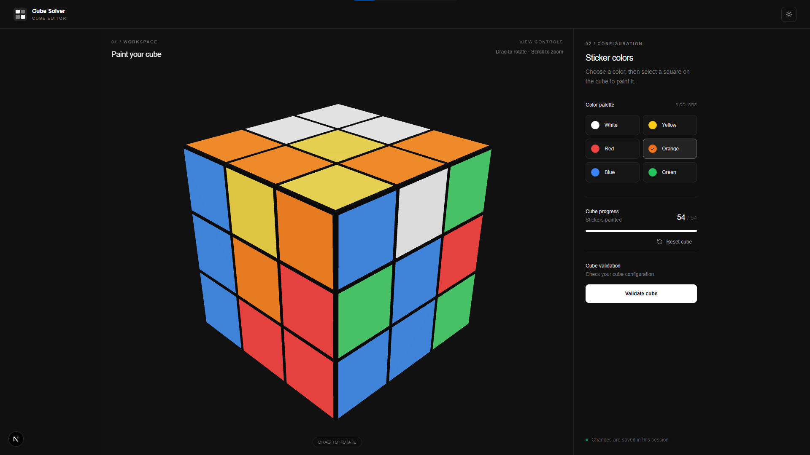
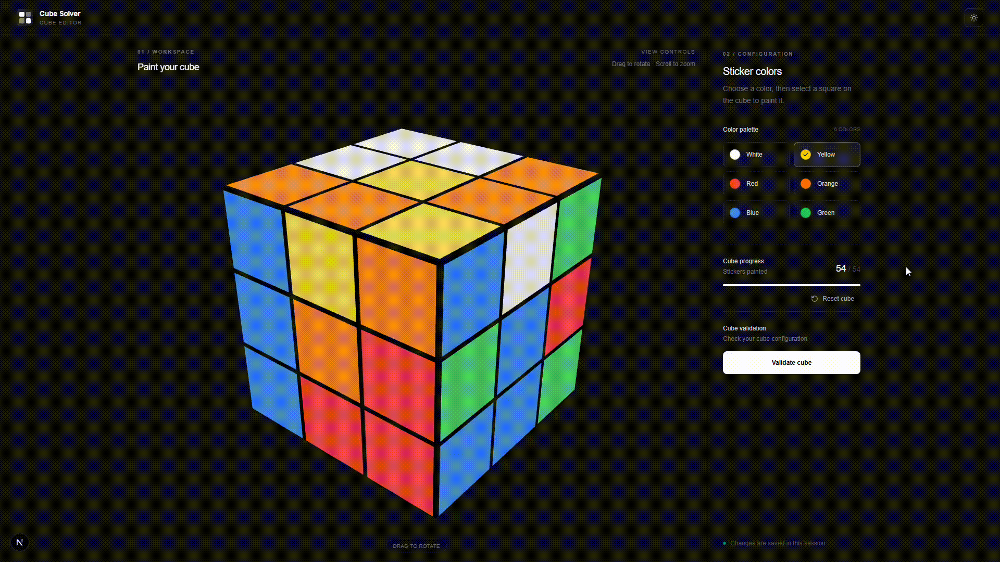
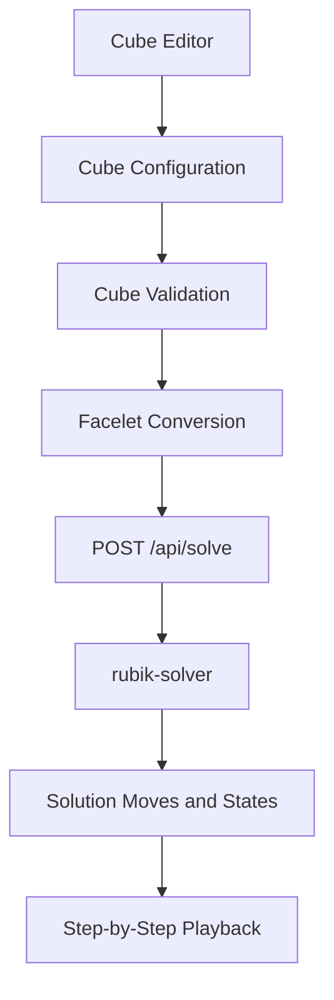

# Rubik's Solver

An interactive Rubik's Solver built with Next.js, React Three Fiber and TypeScript.

Configure your Rubik's Cube using an interactive 3D editor, validate its configuration and generate a step-by-step solution. Rotate the cube, inspect each move and follow the solving process in real time.

<p align="center">
  <a href="https://github.com/vitorbizarra/rubiks-solver">
    
  </a>
  
  
</p>

## Preview

<p align="center">
  
</p>

<p align="center">
  
</p>

## Features

- **Interactive 3D Editor** — Rotate and inspect the Rubik's Cube from any angle.
- **Sticker Configuration** — Paint each sticker using an intuitive color palette.
- **Cube Validation** — Verify the cube configuration and detect invalid states before solving.
- **Automatic Solver** — Generate a solution using the `rubik-solver` package.
- **Step-by-Step Playback** — Follow the solution move by move with interactive playback controls.
- **Light and Dark Themes** — Switch between themes or follow your system preference.

## Tech Stack

| Technology | Purpose |
|---|---|
| [Next.js 16](https://nextjs.org/) | React framework and API routes |
| [React 19](https://react.dev/) | User interface |
| [TypeScript 5](https://www.typescriptlang.org/) | Static typing |
| [Tailwind CSS 4](https://tailwindcss.com/) | Styling |
| [Three.js](https://threejs.org/) | 3D rendering |
| [React Three Fiber](https://r3f.docs.pmnd.rs/) | Three.js integration with React |
| [React Three Drei](https://drei.docs.pmnd.rs/) | Helpers for React Three Fiber |
| [rubik-solver](https://www.npmjs.com/package/rubik-solver) | Rubik's Cube solving algorithm |
| [Lucide React](https://lucide.dev/) | Icons |
| [next-themes](https://github.com/pacocoursey/next-themes) | Theme management |

## Getting Started

### Prerequisites

Make sure you have one of the following package managers installed:

- [Node.js](https://nodejs.org/) 20.9 or later, with npm
- [Yarn](https://yarnpkg.com/)
- [pnpm](https://pnpm.io/)
- [Bun](https://bun.sh/)

Choose one package manager and use it consistently throughout the project.

### Installation

Clone the repository:

```bash
git clone https://github.com/vitorbizarra/rubiks-solver.git
cd rubiks-solver
```

Install the dependencies using your preferred package manager:

**npm**
```bash
npm install
```

**Yarn**
```bash
yarn install
```

**pnpm**
```bash
pnpm install
```

**Bun**
```bash
bun install
```

### Development Server

Start the development server:

**npm**
```bash
npm run dev
```

**Yarn**
```bash
yarn dev
```

**pnpm**
```bash
pnpm dev
```

**Bun**
```bash
bun run dev
```

Open [http://localhost:3000](http://localhost:3000) in your browser.

## How It Works

The application follows a validation and solving workflow:

1. **Configuration** — The user paints the stickers using the interactive 3D editor.
2. **Validation** — The application checks whether the cube has a valid configuration, including color counts, center positions, piece orientation and permutation parity.
3. **Facelet Conversion** — The cube state is converted into the facelet string format expected by the solver, following the `URFDLB` face order.
4. **Solving** — The configuration is sent to the `/api/solve` endpoint, where the `rubik-solver` package generates the solution.
5. **Playback** — The returned moves and cube states are used to display the solution step by step.



## Project Structure

```text
rubiks-solver/
├── app/
│   ├── api/
│   │   └── solve/
│   │       └── route.ts
│   ├── globals.css
│   ├── layout.tsx
│   └── page.tsx
├── components/
│   ├── CubeEditor/
│   │   ├── CubeEditor.tsx
│   │   ├── CubeScene.tsx
│   │   ├── CubeFace.tsx
│   │   ├── ColorPalette.tsx
│   │   └── ...
│   ├── ThemeProvider.tsx
│   └── ThemeToggle.tsx
├── lib/
│   ├── cube-types.ts
│   ├── cube-state.ts
│   ├── cube-validation.ts
│   ├── cube-legality.ts
│   ├── cube-to-facelets.ts
│   └── cube-playback.ts
├── docs/
│   └── images/
├── public/
├── package.json
└── README.md
```

## Main Modules

| Module | Responsibility |
|---|---|
| `cube-types.ts` | Defines cube faces, colors and state types. |
| `cube-state.ts` | Creates and updates cube configurations. |
| `cube-validation.ts` | Validates sticker counts, colors and center positions. |
| `cube-legality.ts` | Checks corner and edge orientation and permutation parity. |
| `cube-to-facelets.ts` | Converts the cube state into the solver's facelet format. |
| `cube-playback.ts` | Reconstructs cube states from the solution moves. |
| `api/solve/route.ts` | Handles solver requests on the server side. |

## Available Scripts

The following scripts are available through the project's `package.json`.

| Script | npm | Yarn | pnpm | Bun |
|---|---|---|---|---|
| Development | `npm run dev` | `yarn dev` | `pnpm dev` | `bun run dev` |
| Production build | `npm run build` | `yarn build` | `pnpm build` | `bun run build` |
| Start production server | `npm run start` | `yarn start` | `pnpm start` | `bun run start` |
| Lint | `npm run lint` | `yarn lint` | `pnpm lint` | `bun run lint` |

## Production Build

Build the application for production:

**npm**
```bash
npm run build
npm run start
```

**Yarn**
```bash
yarn build
yarn start
```

**pnpm**
```bash
pnpm build
pnpm start
```

**Bun**
```bash
bun run build
bun run start
```

## Deployment

The application can be deployed using [Vercel](https://vercel.com/).

1. Push the project to a GitHub repository.
2. Import the repository into Vercel.
3. Configure the project settings if necessary.
4. Deploy the application.

Vercel automatically detects Next.js projects and configures the build process.

## Contributing

Contributions, issues and feature requests are welcome.

Feel free to fork the repository and submit a pull request.

## License

This project is licensed under the MIT License.
See the [LICENSE](LICENSE) file for details.